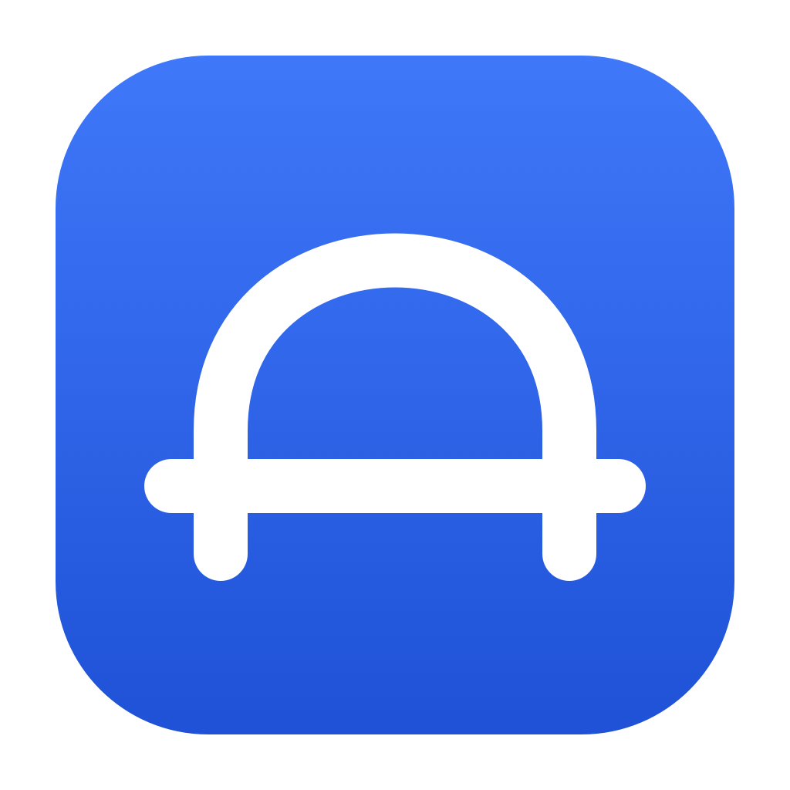

# Bridge

**Your Mac and Android phone, on speaking terms.**

[](LICENSE)
[](docs/BUILDING.md)

Bridge lets you send files, share clipboard text, check notifications, and control a few
things on your Android phone from your Mac. It lives in the Mac menu bar, with a native
Android companion on the other end. Everything travels over your local connection.
There’s no account to make and no cloud service in the middle.

Sending a file to yourself should not require an email subject line.

## What can it do?

| | |
| --- | --- |
| **Files & folders** | Send in either direction, with a persistent queue, pause/retry controls, and SHA-256 verification. Folders are zipped for the trip. |
| **Clipboard** | Send text from your phone, optionally send Mac copies automatically, and keep an optional in-memory history. |
| **Notifications** | See phone notifications on your Mac, dismiss them, and use supported actions and replies. Previews start off. |
| **Phone controls** | Check battery and device info, control supported media sessions, ring the phone, or enable the optional flashlight control. |
| **Links** | Send a web link between devices and open it when you’re ready. |
| **Phone files** | Browse and download from an Android folder you explicitly choose to share. |
| **Shortcuts & CLI** | Use macOS Shortcuts, local automation rules, or the bundled command-line tool. |
| **USB tools** | With an authorized ADB connection: inspect devices and logs, take screenshots, install APKs, and access supported shared-storage paths. |

The ring button is useful when your phone has once again become part of the sofa.

Mac sharing works through Finder, Services, and the Share extension. Android uses the
system share sheet and file pickers. Both apps follow system light/dark appearance;
Android also supports wallpaper colors and an AMOLED-black option.

For transfer limits, permission requirements, and the less exciting but useful details,
see [the feature guide](docs/FEATURES.md).

## What you’ll need

- An **Apple Silicon Mac running macOS 27 or later**.
- An **Android phone running Android 10 or later**.
- Both devices on the same **Wi-Fi or hotspot**, or an authorized **USB/ADB** connection.

Bridge 1.0 is an early release candidate. Builds and automated checks have passed, but
several workflows still need testing on real devices. Expect rough edges, and please
[report reproducible bugs](https://github.com/mlwn4096/Bridge/issues).

Screen mirroring isn’t part of this release. The experimental work stays outside this repo.

## Get connected

Build the apps with [the instructions below](#build-it-yourself). Packaged downloads,
when published, will be on the [Releases page](https://github.com/mlwn4096/Bridge/releases).

1. Open `dist/Bridge-1.0.dmg` and drag **Bridge** into **Applications**. Quit any older
   instance before replacing it, then open the app. Look in the menu bar.
2. Install `dist/Bridge-1.0.apk` on your phone and open it.
3. Keep both devices on the same network. Scan the Mac’s QR code from Android, or paste
   the pairing link, then approve the phone on your Mac. Pairing codes last five minutes.
4. Allow local-network access if asked. For notifications, enable Android notification
   access and Mac notification permission. Sideloaded Android apps may first need
   **Allow restricted settings** in their app settings.

Closing a Mac window keeps Bridge running. **Quit** stops it. Optional permissions and
features can be configured after pairing.

## Build it yourself

For the Mac, you’ll need Swift command-line tools and the macOS 27 SDK. Android needs
JDK 17, SDK platform 37, and build tools 36.0.0. The repo includes a Gradle wrapper;
the first Android build downloads its dependencies.

From the repository root on macOS:

```sh
chmod +x scripts/*.sh scripts/*.zsh android/gradlew
./scripts/test-mac.sh
./scripts/package-mac.sh
./scripts/build-android.sh
```

`package-mac.sh` builds the Mac app and creates its DMG. The Android script runs JVM
tests and builds the APK. Outputs go into `dist/`. For Android builds on Linux or
Windows, SDK setup, and signing options, see [BUILDING.md](docs/BUILDING.md).

Mac builds are ad-hoc signed by default and aren’t notarized. Android builds use your
local debug key unless you configure a release key. An APK signed with a different
key can’t update an existing installation. Keep your release keys backed up and out of Git.

### Prefer a terminal?

The Mac app bundles a Python 3 CLI:

```sh
CLI="/Applications/Bridge.app/Contents/Resources/Tools/bridge-cli"
python3 "$CLI" devices
python3 "$CLI" send ~/Downloads/example.pdf
python3 "$CLI" ring
```

It also supports clipboard, links, and transfer controls. Run `python3 "$CLI" --help`
for the command list. USB developer commands require explicit opt-in flags.

## Where the code lives

```text
mac/         Swift app, menu-bar UI, Share extension, resources, and tests
android/     Kotlin/Compose companion, Gradle wrapper, and a diagnostic app
scripts/     Build tools, packaging, verification, and the CLI
docs/        Architecture, protocol, feature details, and test notes
.github/     Issue and pull request templates
```

Start with [ARCHITECTURE.md](docs/ARCHITECTURE.md) if you’re exploring the code, or
[PROTOCOL.md](docs/PROTOCOL.md) if you’re changing how the two apps talk.

## A few things to know

**Privacy:** Bridge has no telemetry or cloud backend. Pairing requires your approval
and pins the Mac’s TLS certificate. Android protects pairing data with Keystore-backed
encryption. Unpairing revokes trust and pending transfers. Clipboard history is optional,
stays in memory, and disappears when the app exits. See [the protocol](docs/PROTOCOL.md)
for the trust and storage details.

**Android being Android:** background clipboard reads are restricted by the OS, and
notification actions depend on the app that created them. After a reboot or force-stop,
you may need to reopen Bridge. Battery-saving policies can affect the connection too.

**If it won’t connect:** check that both apps are running, the devices share a network,
and local-network permission and the firewall allow the connection. Some Wi-Fi networks
isolate devices. A changed Mac certificate needs fresh pairing; leave TLS validation on.

**If a transfer fails:** a moved or changed source file needs selecting again.
Interrupted transfers restart from the beginning; they don’t resume at the last byte.
The [feature guide](docs/FEATURES.md) explains queues, retries, and save locations.

## Help make it better

Bug reports, small fixes, and clearer docs are welcome. Include your app and OS versions,
connection type, and steps to reproduce. “It broke” is relatable, but difficult to debug.

Read [CONTRIBUTING.md](CONTRIBUTING.md) before opening a pull request. For security issues,
use [SECURITY.md](SECURITY.md) rather than a public bug report. The
[acceptance checklist](docs/FEATURE_IMPLEMENTATION_CHECKLIST.md) and
[verification notes](docs/VERIFICATION.md) track what still needs checking.

## License

[MIT](LICENSE). Use it, change it, build something with it; keep the license notice.
Dependencies keep their own licenses—see [THIRD_PARTY_NOTICES.md](THIRD_PARTY_NOTICES.md).
