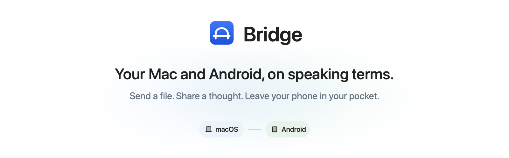

<div align="center">

<picture>
  <source media="(prefers-color-scheme: dark) and (max-width: 600px)" srcset="docs/assets/bridge-header-v2-dark-mobile.png" />
  <source media="(max-width: 600px)" srcset="docs/assets/bridge-header-v2-light-mobile.png" />
  <source media="(prefers-color-scheme: dark)" srcset="docs/assets/bridge-header-v2-dark.png" />
  <source media="(prefers-color-scheme: light)" srcset="docs/assets/bridge-header-v2-light.png" />
  
</picture>

[](docs/BUILDING.md)
[](docs/BUILDING.md)
[](LICENSE)
[](docs/VERIFICATION.md)

**[Get Bridge](#get-bridge)** · **[Features](#less-back-and-forth)** · **[Setup](#get-connected)** · **[Build](#build-it-yourself)** · **[Docs](#explore-the-project)**

[Website](https://mlwn.in) · [Report a bug](https://github.com/mlwn4096/Bridge/issues)

<br />

<a href="https://buymeacoffee.com/mlwn"></a>

</div>

<br />

Bridge lives in your Mac’s menu bar, with a native Android companion on the other end.
Move files, share clipboard text, see phone notifications, and use phone controls
across your devices over a local connection. No account to create. No cloud relay
between your devices.

**Sending a file to yourself should not require an email subject line.**

## Less back and forth

### Files, without the detour

Send files in either direction, or send a whole folder zipped for the trip.
A persistent queue, pause/retry controls, and SHA-256 verification keep transfers
manageable. Share from Finder, macOS Services, the Share extension, or Android’s
system share sheet.

### Copy here. Use there.

Send text from Android, optionally send Mac copies automatically, and keep an
optional clipboard history in memory. Send web links between devices and open
them when you’re ready.

### Your phone can stay over there

See Android notifications on your Mac, dismiss them, and use supported actions
and replies. Check battery and device info, control supported media sessions,
ring your phone, or enable optional flashlight control. Notification previews start off.

The ring button is useful when your phone has once again become part of the sofa.

### A little more, when you need it

| Feature | What it gives you |
| --- | --- |
| **Phone files** | Browse and download from an Android folder you explicitly choose to share. |
| **Shortcuts & automation** | macOS Shortcuts, local automation rules, and a bundled Python CLI. |
| **USB tools** | With an authorized ADB connection: device inspection, logs, screenshots, APK installation, and supported shared-storage access. |
| **Feels at home** | System light/dark appearance on both platforms; wallpaper colors and an AMOLED-black option on Android. |

[Explore all features and limits →](docs/FEATURES.md)

## Get Bridge

**[Visit GitHub Releases →](https://github.com/mlwn4096/Bridge/releases)**

Packaged downloads, when published, appear under a release’s **Assets**: the
`.dmg` for your Mac and the `.apk` for your Android phone. If installers aren’t
available yet, [build both apps from source](#build-it-yourself).

| Mac | Android | Connection |
| --- | --- | --- |
| Intel or Apple Silicon · macOS 13+ on supported hardware | Android 10+ | Same Wi-Fi or hotspot, or authorized USB/ADB |

Both Mac editions have the same features. Check **Apple menu → About This Mac**:
“Processor: Intel” needs the Intel download; “Chip: Apple M…” needs Apple Silicon.
The compatibility target is macOS 13–27 on Apple-supported hardware combinations.
See [compatibility and verification status](docs/COMPATIBILITY.md) before deployment.

> **Older OS versions are untested.** macOS 13, 14, 15 and 26 have not been
> runtime-tested for this compatibility update. The Android 10–17 device matrix
> is also untested. Mac checks ran on macOS 27 with Apple Silicon; Intel checks
> ran under Rosetta, not on an Intel Mac. These are compatibility targets,
> not verified support or equal-speed guarantees.

> **Early release candidate.** Builds and automated checks have passed, but several
> workflows still need real-device testing. Expect rough edges. Screen mirroring
> is outside this release. [See verification status →](docs/VERIFICATION.md)

## Get connected

On first launch, each app helps you download the companion for the other device.
Use **Already installed?** at the bottom to continue to pairing. Android can also
prepare an email with the Mac download link; optional automatic delivery uses a
[separately configured n8n workflow](docs/DOWNLOAD_ONBOARDING.md).

1. Open `dist/Bridge-Intel.dmg` for an Intel Mac or `dist/Bridge-AppleSilicon.dmg`
   for an Apple Silicon Mac, then drag **Bridge** into **Applications**. Quit any older
   instance before replacing it, then open the app. Look in the menu bar.
2. Install `dist/Bridge-1.0.apk` on your phone and open it.
3. Keep both devices on the same network. Scan the Mac’s QR code from Android, or paste
   the pairing link, then approve the phone on your Mac. Pairing codes last five minutes.
4. Allow local-network access if asked. For notifications, enable Android notification
   access and Mac notification permission. Sideloaded Android apps may first need
   **Allow restricted settings** in their app settings.

Closing a Mac window keeps Bridge running. **Quit** stops it. Optional permissions and
features can be configured after pairing.

## Build it yourself

<details>
<summary><strong>Build the Mac and Android apps</strong></summary>

For the Mac, you’ll need Swift command-line tools and the macOS 27 SDK. Android needs
JDK 17, SDK platform 37, and build tools 36.0.0. The repo includes a Gradle wrapper;
the first Android build downloads its dependencies.

From the repository root on macOS:

```sh
chmod +x scripts/*.sh scripts/*.zsh android/gradlew
./scripts/test-mac.sh
./scripts/package-mac.sh
./scripts/build-android.sh
```

`package-mac.sh` builds the Mac app and creates its DMG. The Android script runs JVM
tests and builds the APK. Outputs go into `dist/`. For Android builds on Linux or
Windows, SDK setup, and signing options, see [BUILDING.md](docs/BUILDING.md).

Mac builds are ad-hoc signed by default and aren’t notarized. Android builds use your
local debug key unless you configure a release key. An APK signed with a different
key can’t update an existing installation. Keep your release keys backed up and out of Git.

</details>

<details>
<summary><strong>Use the bundled command-line tool</strong></summary>

The Mac app bundles a Python 3 CLI:

```sh
CLI="/Applications/Bridge.app/Contents/Resources/Tools/bridge-cli"
python3 "$CLI" devices
python3 "$CLI" send ~/Downloads/example.pdf
python3 "$CLI" ring
```

It also supports clipboard, links, and transfer controls. Run `python3 "$CLI" --help`
for the command list. USB developer commands require explicit opt-in flags.


</details>

## Private by design

Bridge has no telemetry or cloud backend. Pairing requires your approval
and pins the Mac’s TLS certificate. Android protects pairing data with Keystore-backed
encryption. Unpairing revokes trust and pending transfers. Clipboard history is optional,
stays in memory, and disappears when the app exits. See [the protocol](docs/PROTOCOL.md)
for the trust and storage details.

## A few things to know

**Android being Android:** background clipboard reads are restricted by the OS, and
notification actions depend on the app that created them. On Android 10–11,
mirroring and dismissal remain available; use your phone for notification actions
and replies. Wallpaper colors require Android 12+, and automatic direct hotspot
setup requires Android 16.1+; manual hotspot connections remain available below that. After a reboot or force-stop,
you may need to reopen Bridge. Battery-saving policies can affect the connection too.

**If it won’t connect:** check that both apps are running, the devices share a network,
and local-network permission and the firewall allow the connection. Some Wi-Fi networks
isolate devices. A changed Mac certificate needs fresh pairing; leave TLS validation on.

**If a transfer fails:** a moved or changed source file needs selecting again.
Interrupted transfers restart from the beginning; they don’t resume at the last byte.
The [feature guide](docs/FEATURES.md) explains queues, retries, and save locations.

## Explore the project

| Start here | What’s inside |
| --- | --- |
| [Feature guide](docs/FEATURES.md) | Transfer limits, permissions, queues, and save locations. |
| [Architecture](docs/ARCHITECTURE.md) | How the Swift Mac app and Kotlin Android companion fit together. |
| [Protocol & trust](docs/PROTOCOL.md) | Pairing, transport, certificate pinning, and storage. |
| [Compatibility](docs/COMPATIBILITY.md) | Mac processor downloads, OS fallbacks and pending device checks. |
| [Build guide](docs/BUILDING.md) | SDK setup, platform instructions, and signing options. |
| [Verification](docs/VERIFICATION.md) | Completed checks and remaining device testing. |
| [Acceptance checklist](docs/FEATURE_IMPLEMENTATION_CHECKLIST.md) | Workflows to check before release. |

<details>
<summary><strong>Source layout</strong></summary>

| Directory | Contents |
| --- | --- |
| `mac/` | Swift app, menu-bar UI, Share extension, resources, and tests. |
| `android/` | Kotlin/Compose companion, Gradle wrapper, and diagnostic app. |
| `scripts/` | Build tools, packaging, verification, and CLI. |
| `docs/` | Architecture, protocol, feature details, and testing notes. |
| `.github/` | Issue and pull request templates. |

</details>

## Help make it better

Bug reports, small fixes, and clearer docs are welcome. Include your app and OS versions,
connection type, and steps to reproduce. “It broke” is relatable, but difficult to debug.

Read [CONTRIBUTING.md](CONTRIBUTING.md) before opening a pull request. For security issues,
use [SECURITY.md](SECURITY.md) rather than a public bug report. The
[acceptance checklist](docs/FEATURE_IMPLEMENTATION_CHECKLIST.md) and
[verification notes](docs/VERIFICATION.md) track what still needs checking.

## License

[MIT](LICENSE). Use it, change it, build something with it; keep the license notice.
Dependencies keep their own licenses—see [THIRD_PARTY_NOTICES.md](THIRD_PARTY_NOTICES.md).

---

<div align="center">

Made by [mlwn](https://mlwn.in). Built for the devices you already have.

If Bridge earns a place in your menu bar, a star helps others find it.
[A coffee helps too.](https://buymeacoffee.com/mlwn)

</div>
